<div align="center">
  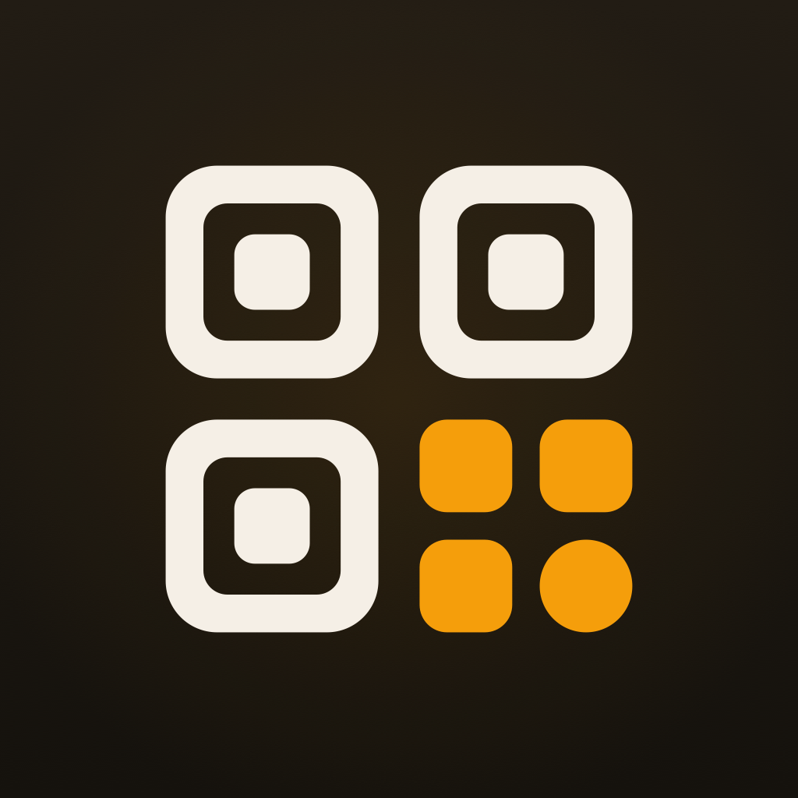
  <h1>QRNest</h1>
  <p>
    <strong>Scan, Create &amp; Organize QR Codes — Built with Kotlin Multiplatform &amp; Compose Multiplatform</strong>
  </p>
  <p>
    
    
    
    
  </p>
</div>

---

## About

**QRNest** is a cross-platform QR code scanner, generator, and history manager migrated and redesigned from the Android project **QRCraft** into a full **Kotlin Multiplatform (KMP)** application targeting **Android** and **iOS**.

It shares business logic, local persistence, design tokens, and UI across platforms using **Compose Multiplatform**, while integrating native camera, image picking, clipboard, and photo saving capabilities on each platform—with adaptive layouts supporting phones, landscape mode, and foldable form factors.

---

## Features

- **QR Scanner** — Real-time camera scanning with adaptive viewfinder, flashlight toggle, and gallery image QR decoding.
- **QR Generator** — Create QR codes for **Text**, **Link**, **Contact**, **Phone Number**, **Geolocation**, and **Wi-Fi**.
- **Specimen Preview & Actions** — Edit titles, toggle favorites, copy content, share, and save generated QR codes as images.
- **History Management** — Tabbed history (**Scanned** / **Generated**) with favorite pinning and adaptive multi-column grids on wide screens.
- **Adaptive Navigation** — Floating pill bottom bar on compact screens and navigation rail on expanded/landscape screens.

---

## Screenshots

### Android (Portrait)

| Scan | Create | Preview | History |
| :---: | :---: | :---: | :---: |
| 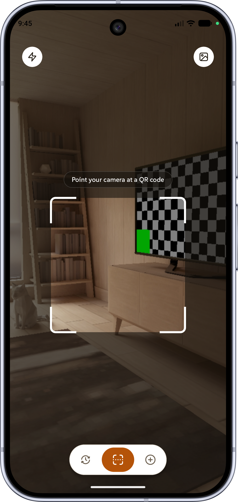 | 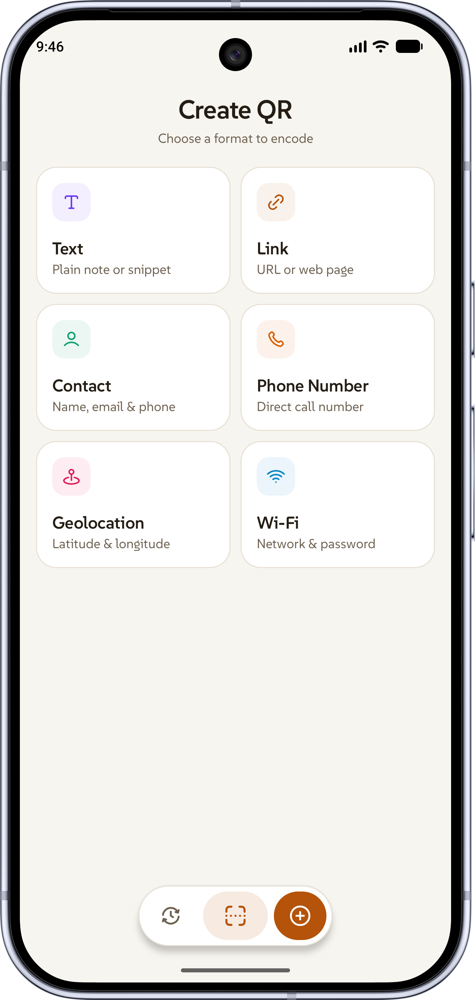 | 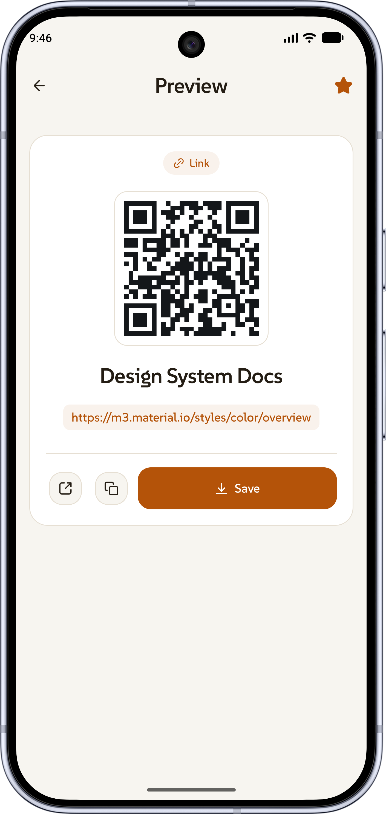 | 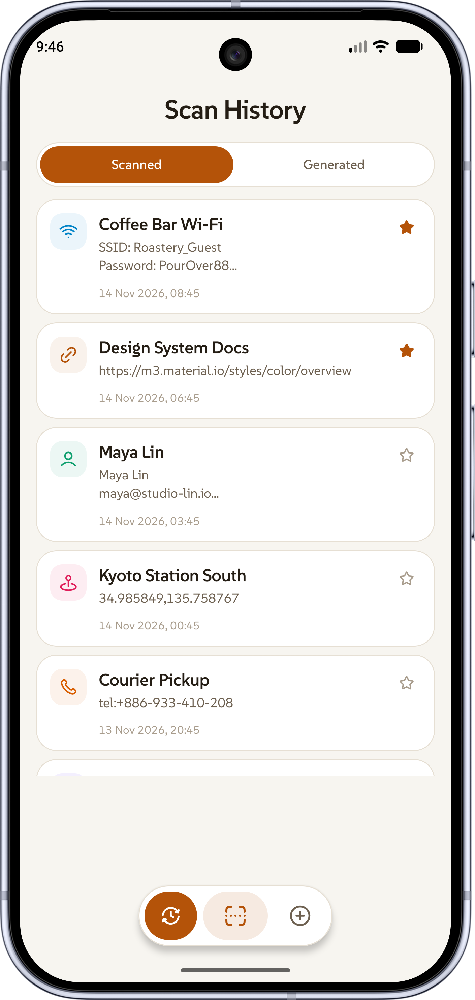 |

### Android (Landscape)

| Scan | Create |
| :---: | :---: |
| 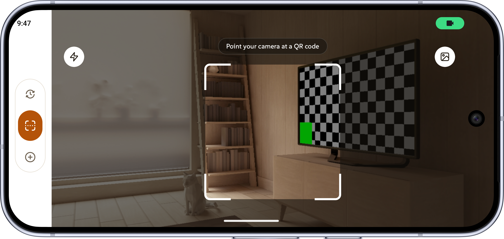 | 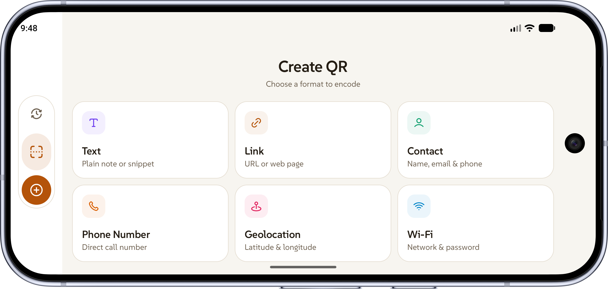 |

| Preview | History |
| :---: | :---: |
| 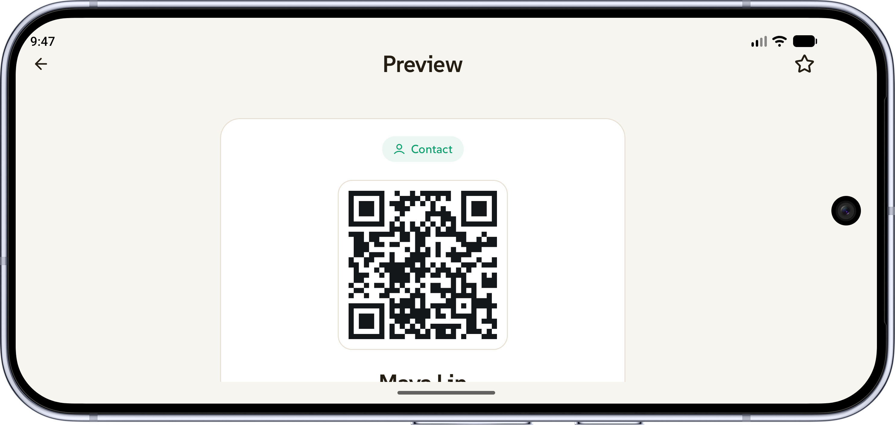 | 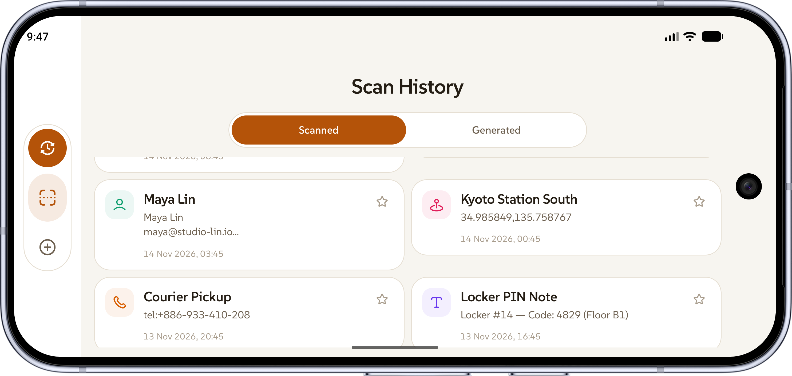 |

### iOS

| Scan | Create | Preview | History |
| :---: | :---: | :---: | :---: |
| 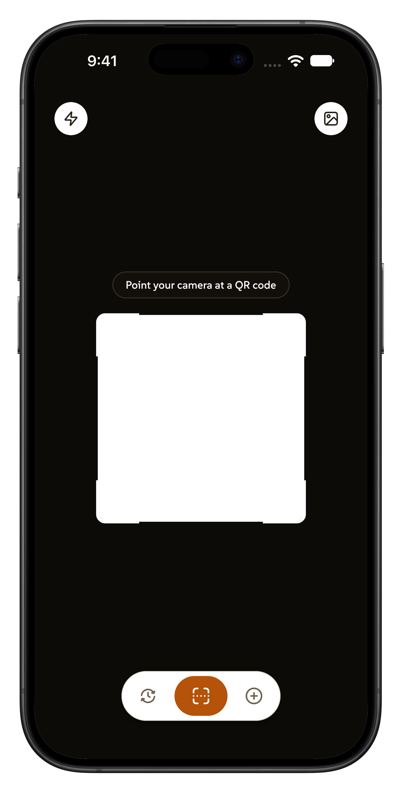 | 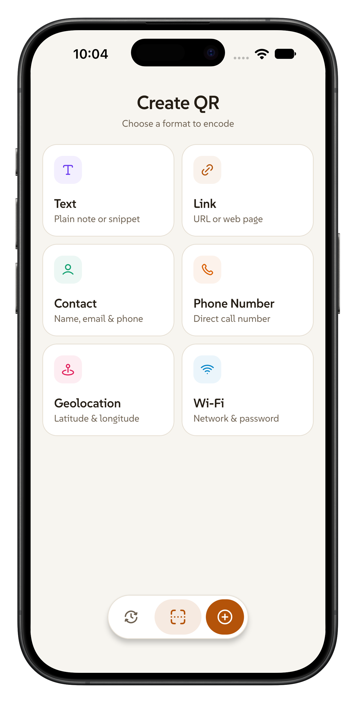 | 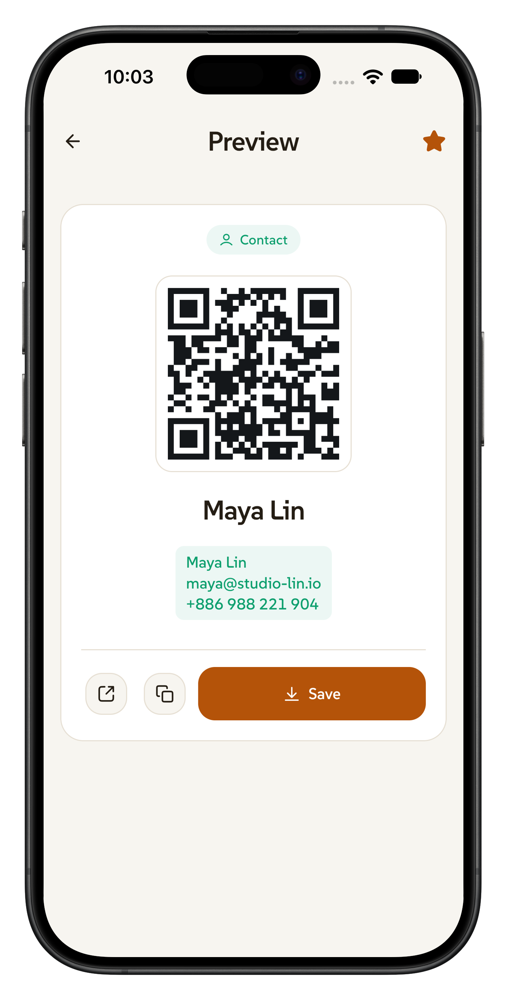 | 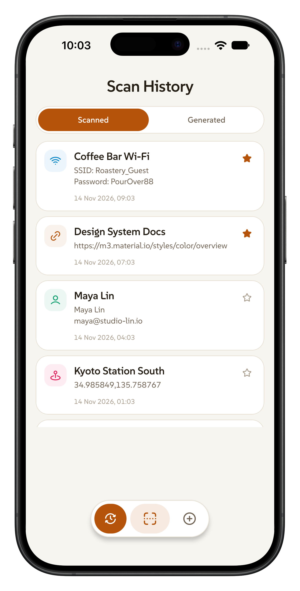 |

### iOS Duo (Folded & Unfolded)

#### Folded
| Scan | Create | Preview | History |
| :---: | :---: | :---: | :---: |
| 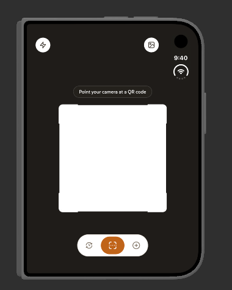 | 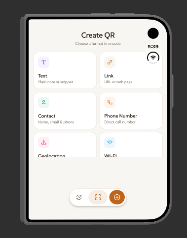 | 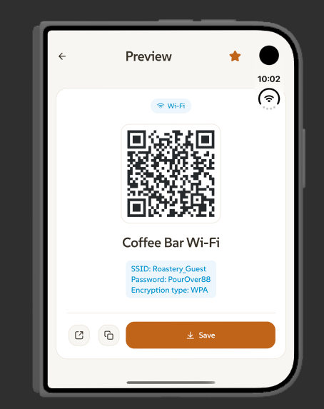 | 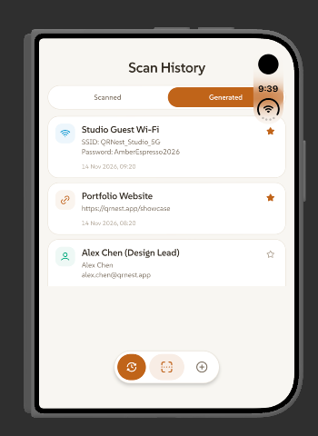 |

#### Unfolded
| Scan | Create |
| :---: | :---: |
| 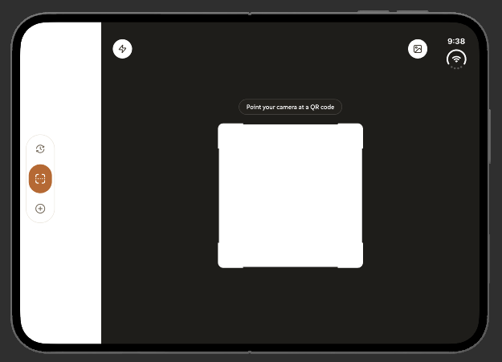 | 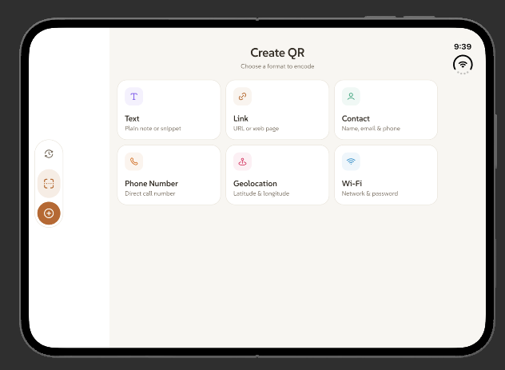 |

| Preview | History |
| :---: | :---: |
| 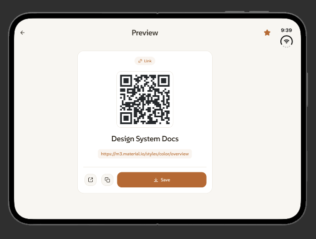 | 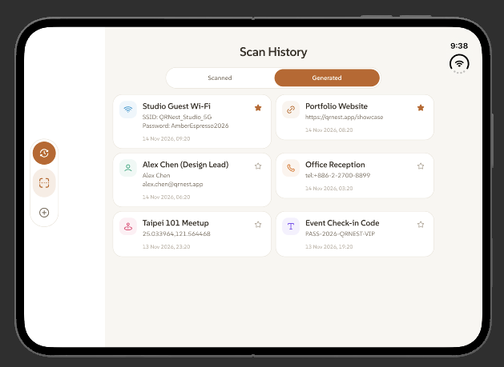 |

---

## Tech Stack

| Category | Technology |
| :--- | :--- |
| **Language & UI** | Kotlin `2.4.21`, Compose Multiplatform `1.12.2`, Material 3 |
| **Architecture** | Clean Architecture + MVI (`State`, `Action`, `Event`), Multi-Module (`:core:*`, `:feature:*`) |
| **Build System** | Gradle Convention Plugins (`:build-logic`), Version Catalog (`libs.versions.toml`) |
| **DI** | Koin `4.2.2` (`koin-core`, `koin-compose-viewmodel`, `koin-android`) |
| **Navigation** | Type-Safe Navigation Compose `2.9.2` |
| **Persistence** | Room KMP `2.8.5` + Bundled SQLite `2.6.2` |
| **QR Generation** | QRose `1.1.2` |
| **QR Scanning (Android)** | CameraX `1.4.2` + Google ML Kit Barcode Scanning `17.3.0` |
| **QR Scanning (iOS)** | Native `AVFoundation` & `Vision` (`VisionQrImageScanner`) |
| **Async & Utilities** | `kotlinx-coroutines`, `kotlinx-serialization`, `kotlinx-datetime` |
| **Testing** | `kotlin.test`, AssertK `0.28.1`, Turbine `1.2.1`, `kotlinx-coroutines-test` |

---

## Module Structure

```text
QRNest
├── androidApp                 # Android application entry point, launcher/splash resources
├── iosApp                     # iOS Xcode project & SwiftUI entry point
├── composeApp                 # Shared KMP app entry, root navigation & Koin setup
├── build-logic                # Custom Gradle convention plugins
├── core
│   ├── domain                 # Shared domain models, Result wrapper & QR payload parser
│   ├── database               # Room KMP database, DAO & platform DatabaseFactory
│   ├── data                   # Repository implementations & mappers
│   ├── designsystem           # Theme, warm amber/espresso color tokens, typography & components
│   └── presentation           # Shared MVI helpers, UiText & adaptive navigation chrome
└── feature
    ├── scan                   # domain / data / presentation
    ├── generate               # domain / data / presentation
    ├── history                # domain / data / presentation
    └── preview                # domain / data / presentation
```

---

## Getting Started

### Android
```bash
./gradlew :androidApp:assembleDebug
```
Or run the `androidApp` configuration directly from Android Studio.

### iOS
Open [iosApp/iosApp.xcodeproj](iosApp/iosApp.xcodeproj) in Xcode and run on an iOS simulator or device.
